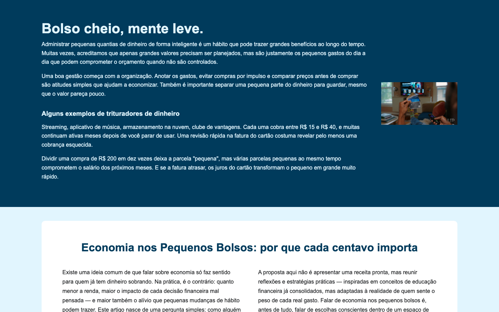
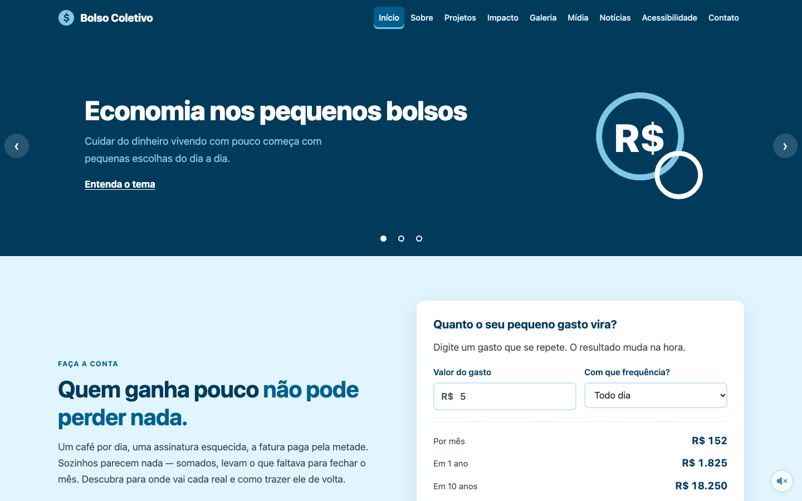
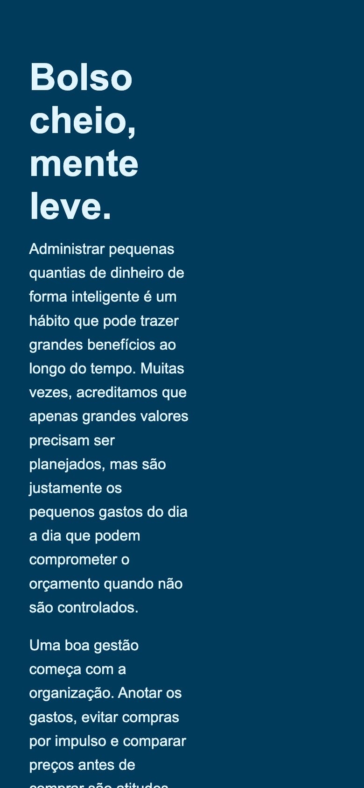

# Melhorias desde o MVP (1ª entrega)

Comparação entre a **1ª entrega** (commit `db12e01`, "primeira entrega", 26/09/2026) e a **versão final**
publicada em https://pequenosvalores.site/.

> **Pontos apontados pelo professor na 1ª entrega:** a equipe acrescenta aqui o retorno recebido e
> indica em qual linha da tabela abaixo cada ponto foi resolvido.

## Antes e depois

| | 1ª entrega (MVP) | Versão final |
|---|---|---|
| Computador |  |  |
| Celular |  |  |

## O que mudou, ponto a ponto

| Ponto | 1ª entrega (MVP) | Como foi resolvido |
|-------|------------------|--------------------|
| Páginas | Só `index.html` tinha conteúdo; os outros 9 arquivos (`blog`, `planos`, `portfolio`, `servicos`, `faq`…) estavam vazios, vindos de um modelo de agência. | 13 páginas com conteúdo próprio do tema: as 10 pedidas no enunciado (incluindo `orcamento_hospedagem.html`) e mais O tema, Aprofundamento e Simuladores. |
| Navegação | Sem `<nav>` e sem nenhum link entre páginas. | Menu igual em todas as páginas, com a página atual marcada (`aria-current`), e rodapé com links para todo o site. |
| Títulos e semântica | Dois `<h1>` na página inicial. | Um único `<h1>` por página, hierarquia de títulos sem pulos e `header`, `nav`, `main`, `footer` em todas. Validador W3C: 0 erros. |
| Celular | O texto ficava espremido em meia tela, com título enorme (ver print acima). | Layout mobile-first: menu vira o botão “Menu” abaixo de 1200 px e tabelas rolam dentro de um quadro. |
| CSS | Cores escritas direto em cada regra e uma única `@media`. | Paleta e medidas em variáveis no `:root`, foco visível (`:focus-visible`) e uma folha de estilo comentada. |
| Imagens | Uma imagem PNG de 1,4 MB com `alt="icone de dinheiro"`, que não descrevia a foto. | Imagens em WebP com menos de 300 KB e `alt` que descreve o que aparece. |
| JavaScript | Nenhum. | 7 scripts: formulário com validação e rascunho, simuladores, notícias, leitura por áudio, menu, carrossel e gráfico de barras. |
| Formulário | Página de contato vazia. | Formulário validado em JavaScript, com mensagem de erro em cada campo, borda em destaque e rascunho salvo no `localStorage`. |
| Acessibilidade | Não era tratada. | Atalho “Pular para o conteúdo”, navegação por teclado, `aria-live` nos resultados, contraste AA, leitura por áudio, vídeo com legenda e página de acessibilidade. |
| Publicação | Pasta local entregue em `.zip`. | Site publicado com HTTPS na Railway, no domínio pequenosvalores.site. |
| Documentação | README com uma linha. | Pasta `docs/` com README, diário de bordo, escopo, orçamento, evidências de testes, plano de contexto e esta página. |

## Como ver a 1ª entrega

```bash
git switch --detach db12e01
```

Depois, abra o `index.html` no navegador. Para voltar: `git switch develop`.
